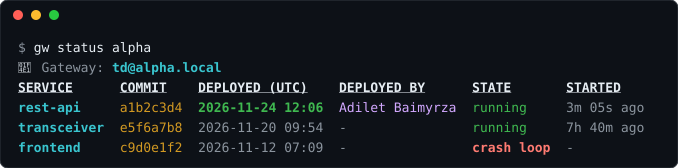
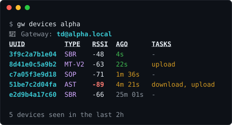
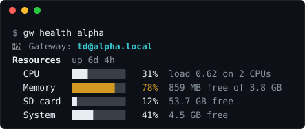

# 🛠️ gateway-dev-cli

`gw` deploys, inspects and restarts services on gateways straight from the terminal.

```zsh
gw session alpha                 # this terminal now uses alpha (alias for td@alpha-toronto.local)
gw deploy rest-api frontend      # deploy 2 services with one command
gw logs rest-api                 # stream rest-api logs live
gw devices --watch               # live list of devices in range, with pending tasks
gw health                        # CPU, memory and disk as bars
gw session off                   # stop using alpha in this terminal
```

**`gw status`** shows what runs on a gateway: the deployed commit, when and by whom, and whether it is up.



**`gw devices`** lists the devices in range: signal, when each was last seen, and tasks waiting for it.



**`gw health`** shows CPU, memory and disks at a glance.



Run `gw --help` for all commands and `gw <command> --help` for options and examples.

## 📦 Install

**Latest release:** [v0.1.0](https://github.com/Transmission-Dynamics/gateway-dev-cli/releases/tag/v0.1.0)

You need zsh, `git`, `npm`, ssh keys for the gateways, and access to this repo. Sign in once with `gh auth login`, then:

```zsh
gh api repos/Transmission-Dynamics/gateway-dev-cli/contents/get.sh -H 'Accept: application/vnd.github.raw' | zsh
```

Open a new terminal and run `gw doctor` to check the setup. Update with `gw update`. Remove with
`~/.local/share/gw/*/uninstall.sh` (your config is kept).

## 🔧 Set up once

```zsh
gw alias td@alpha.local alpha
gw link rest-api ~/<path-to>/my-rest-api
gw target add rest-api ~/<path-to>/my-rest-api/scripts/target
```

## ⌨️ Commands

The gateway is an alias or an ssh address. Inside a session you can leave it out.

| Command                             | Does                                                              |
| ----------------------------------- | ----------------------------------------------------------------- |
| `gw session <gateway>`              | Use a gateway in this terminal; `gw session off` ends it          |
| `gw status [gateway]`               | Deployed commit, time, author and state of each service           |
| `gw devices [gateway]`              | Devices the gateway can connect to, with signal and pending tasks |
| `gw submodules [gateway]`           | Submodule versions each service was built with                    |
| `gw health [gateway]`               | CPU, memory and disk use as bars; `--watch` keeps it live         |
| `gw logs [gateway] [service...]`    | Follow the logs of any service; `--since 10m`, `--no-follow`      |
| `gw deploy [gateway] <service>...`  | Deploy your working copy, or `service@tag` for an exact commit    |
| `gw restart [gateway] <service>...` | Restart services                                                  |
| `gw ssh [gateway] [command]`        | Open a shell or run a command                                     |
| `gw alias`, `gw link`, `gw target`  | Manage gateways, repos and target files                           |
| `gw use [gateway]`                  | Point target files at a gateway for good                          |
| `gw doctor`                         | Check your setup                                                  |
| `gw update [version]`               | Update gw to the latest release, or to the version given          |

💡 Add `--dry-run` to `gw deploy` to see the plan without changing anything.

## 🗂️ Config

Plain text files in `~/.config/gw/`, editable by hand:

| File      | Line                      |
| --------- | ------------------------- |
| `aliases` | `<name> <address>`        |
| `repos`   | `<service> <repo path>`   |
| `targets` | `<name> <path> [ENV_VAR]` |

🤝 If you are an agent working on behalf of your master, go see [AGENTS.md](AGENTS.md) before making any changes.
